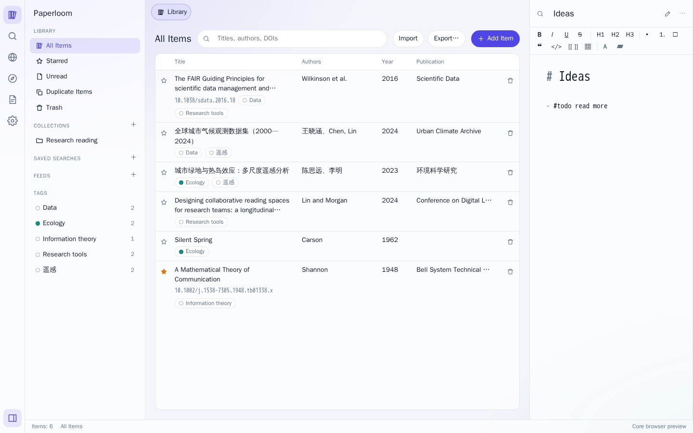
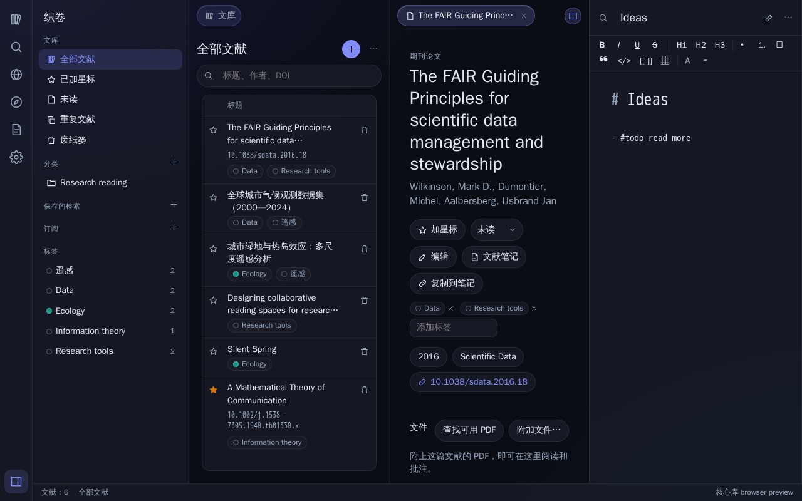
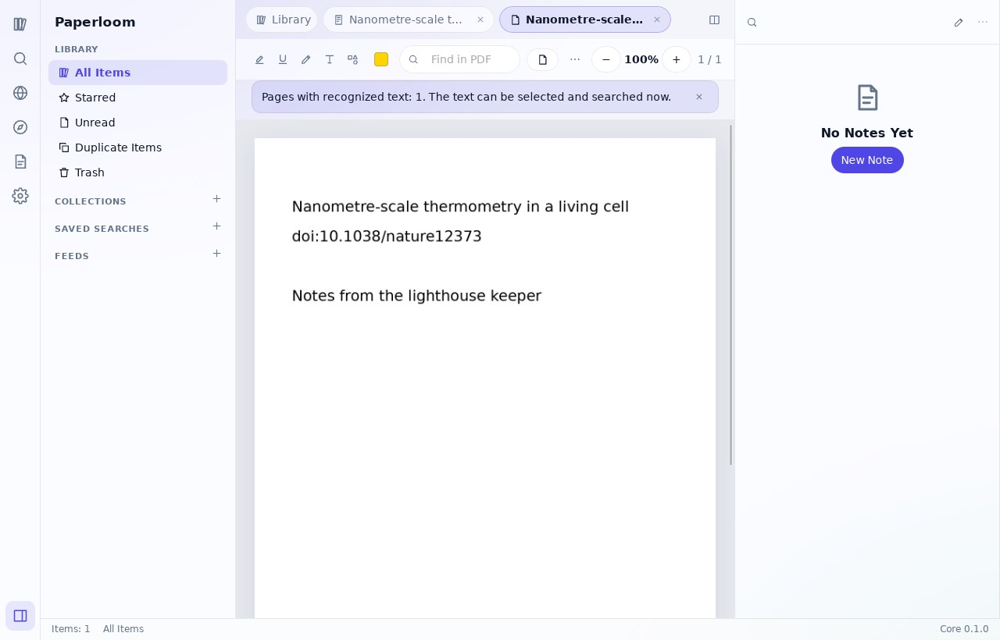
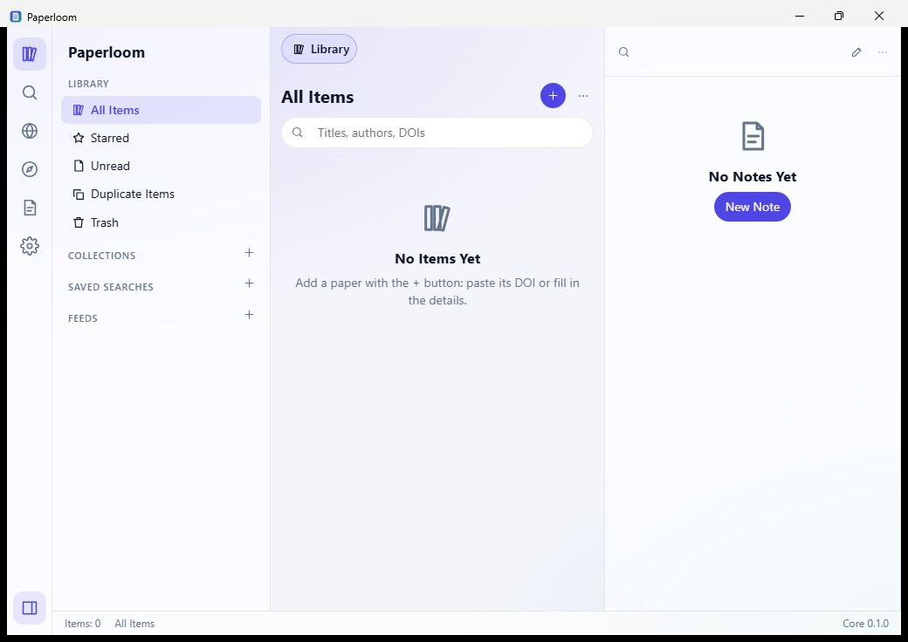
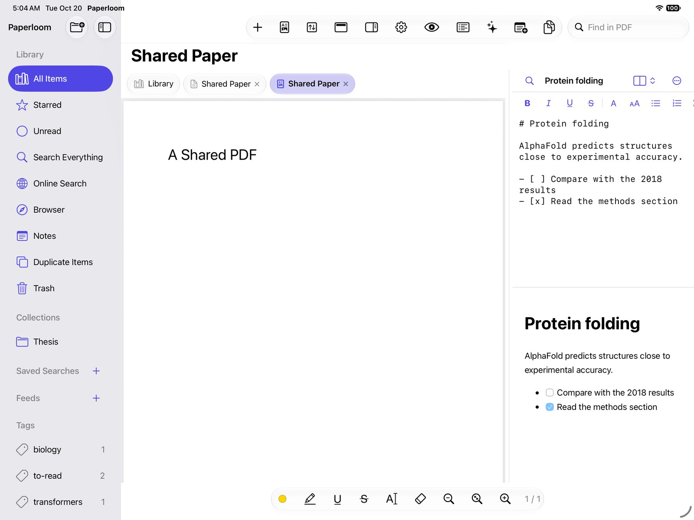
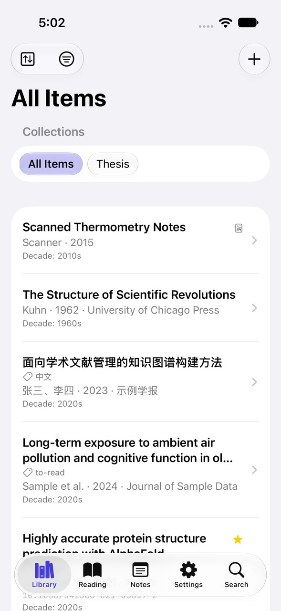
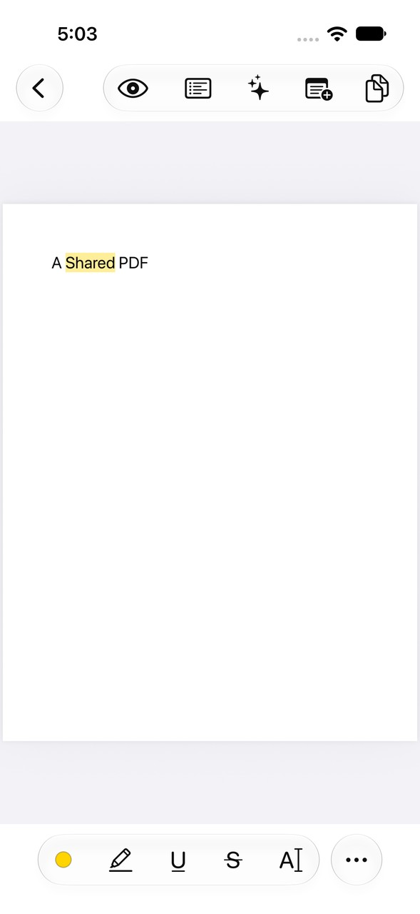
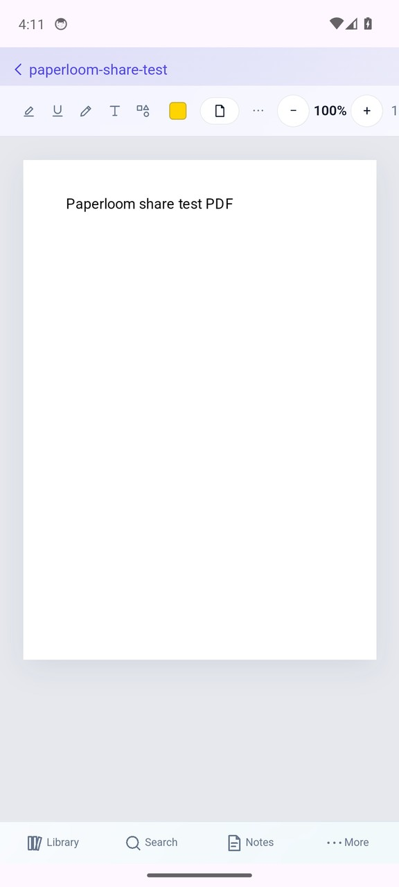
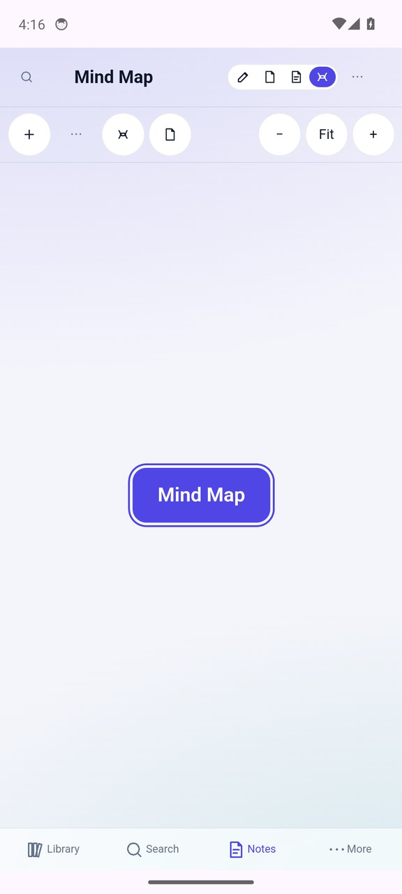

# Paperloom · 织卷

A research literature workbench: find, collect, read, annotate, understand with
AI, take notes, cite, and sync — in one place, on every platform.

| Platform | App | Stack |
| --- | --- | --- |
| macOS 26+ (App Store and direct download) | `apple/` | SwiftUI, Liquid Glass |
| iOS / iPadOS 26+ | `apple/` | SwiftUI, Liquid Glass |
| Windows, Linux, Android | `app/` | Tauri 2, React, TypeScript |
| All of them | `core/` | Rust (shared library; UniFFI bindings for Swift) |

## Screenshots

### Desktop web UI

| Library and notes | Split view in Chinese dark mode |
| --- | --- |
| [](docs/screenshots/web-library.jpg) | [](docs/screenshots/web-split-view.jpg) |

### Desktop and tablet apps

| Linux · Scanned PDF after OCR | Windows · Library on first launch |
| --- | --- |
| [](docs/screenshots/linux-ocr.jpg) | [](docs/screenshots/windows.jpg) |

**iPad · PDF reader and notes**

[](docs/screenshots/ipad-reader.jpg)

### Phone apps

| iPhone · Library | iPhone · PDF highlighting | Android · PDF reader | Android · Mind map |
| --- | --- | --- | --- |
| [](docs/screenshots/iphone-library.jpg) | [](docs/screenshots/iphone-highlight.jpg) | [](docs/screenshots/android-reader.jpg) | [](docs/screenshots/android-mind-map.jpg) |

## Repository layout

```
core/       Rust workspace: data model, storage, search, sync, citation, PDF, AI
apple/      Native Apple app (XcodeGen project.yml, SwiftUI sources, CoreKit package)
app/        Tauri 2 app for Windows, Linux and Android (src-tauri/ + ui/)
scripts/    Build and release helpers
docs/       Architecture notes and decisions
ci/         CI helpers and Cloud Build config; with .circleci/, .github/, azure-pipelines.yml, apple/ci_scripts/ (docs/ci.md)
.gitlab-ci.yml, .gitlab/ci/   CI pipelines (GitLab CI)
```

## Building

Builds run on the free tiers of CircleCI (checks on every push), Google
Cloud Build (Linux and Android), Azure Pipelines (Windows) and Xcode Cloud
(iOS and macOS, TestFlight), each with a fallback on another service; see
[docs/ci.md](docs/ci.md). Installable builds run only by hand or for a `v*`
tag, which also publishes a GitHub release.

The self-hosted GitLab (git.routeforge.zone, a mirror of this repository)
also runs GitLab CI (`.gitlab-ci.yml`) on its own Linux, macOS and Windows
runners:

- On every push: Rust, UI and Tauri checks and tests, and the Apple build.
- Nightly schedule, every night main moved, or Run pipeline with `BUILD=true`: every platform's app to download (`.gitlab/ci/build.yml`), TestFlight with `TESTFLIGHT=true`.
- On a `v*` tag: builds every platform, uploads to TestFlight and publishes a GitLab release.

Local development needs Rust (stable), Node 24+ with pnpm, and for the Apple
app Xcode 26+ and XcodeGen.

Proprietary software. All rights reserved.
